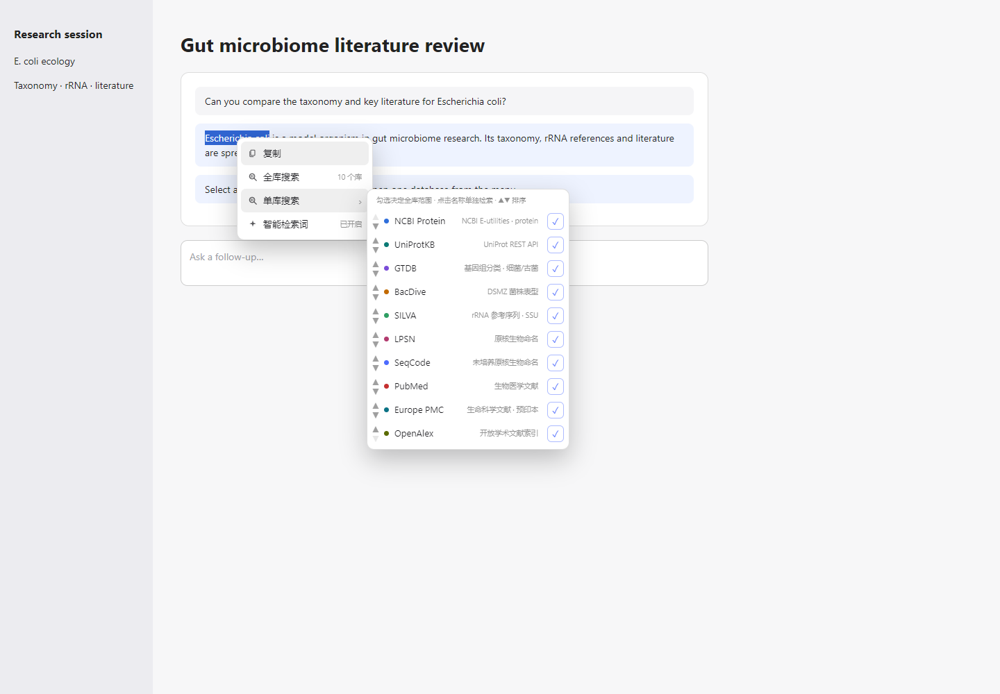

# dsh-multidb-lens

[English](README.md) | [简体中文](README.zh-CN.md)

A DeepSeek Harness (DSH) web UI plugin. Select text in a conversation, right-click, and search **ten protein, microbiome and literature databases** — all at once or one at a time. Every source loads and fails independently, and results are rendered in a grouped, sandboxed iframe.




---

## Databases

| ID | Database | Coverage | Integration |
|----|----------|----------|-------------|
| `ncbi` | **NCBI Protein** | Protein sequences | E-utilities `esearch → esummary` (`db=protein`) |
| `uniprot` | **UniProtKB** | Protein function and annotation | UniProt REST `uniprotkb/search` |
| `gtdb` | **GTDB** | Bacterial/archaeal genome taxonomy and phylogeny | GTDB public FastAPI `/search/gtdb`; returns genomes, GTDB lineages and species-representative flags |
| `bacdive` | **BacDive** | Strain phenotypes, culture and isolation data (DSMZ) | Public search page `bacdive.dsmz.de/search` (the official REST API now requires an account) |
| `silva` | **SILVA** | SSU rRNA reference sequences and taxonomy | SILVA Web Service `legatum.arb-silva.de/WS/`; stats and results are fetched together |
| `lpsn` | **LPSN** | Prokaryotic nomenclature and valid-publication status | Public search page `lpsn.dsmz.de/search` |
| `seqcode` | **SeqCode** | Genome-based names for uncultured prokaryotes | SeqCode Registry search page `registry.seqco.de/search` |
| `pubmed` | **PubMed** | Biomedical and life-science literature | NCBI E-utilities `esearch → esummary` (`db=pubmed`) |
| `europepmc` | **Europe PMC** | PubMed, PMC full text and bioRxiv/medRxiv preprints | Europe PMC REST `search` (`resultType=lite`) |
| `openalex` | **OpenAlex** | Open scholarly index, DOIs and citation counts | OpenAlex REST `/works` |

- The five microbiome sources target microbial ecology, evolution and nomenclature. GTDB, SILVA and SeqCode are especially useful for uncultured organisms and MAGs.
- The three literature sources target paper discovery: PubMed is the classic biomedical index, Europe PMC covers preprints and open-access full text, and OpenAlex adds cross-disciplinary DOI and citation metadata.

## Features

- **Context menu**: the custom menu appears only when text is selected inside the conversation body (`[data-chat-flow]`). It contains **Copy** (复制), **Search all** (全库搜索), **Search one database** (单库搜索 ▸) and **Smart query** (智能检索词). A **BLAST** (BLAST 比对 ▸) entry is added when the selection is a sequence or a UniProt accession. With no selection, or when the selection is in the composer or sidebar, the system context menu is left untouched.
- **Single-database submenu**: hovering “Search one database” opens all ten sources. Click a name to search that source alone, use the checkbox to include/exclude it from “Search all”, and use `▲▼` to reorder. Switches and order persist in `localStorage`. Keyboard users can enter with `ArrowRight`/`ArrowDown` and return with `ArrowLeft`. The submenu flips horizontally and vertically to stay inside the viewport and scrolls when needed.
- **Smart query**: detects DOIs, PMIDs, UniProt/NCBI/GTDB accessions, DNA/protein sequences and taxon names, then phrases the query in each provider's syntax (for example PubMed `[DOI]`, UniProt `organism_name:`, Europe PMC `TITLE_ABS:`, and OpenAlex DOI/PMID filters). The result panel shows what was detected and offers one-click **Retry as raw text** or **Switch to smart mode**.
- **BLAST**: selecting a DNA/protein sequence or a UniProt accession adds a prefilled NCBI BLAST action (`blastn`/`blastp`). Accessions also get a UniProt BLAST action.
- **Selection normalization**: trims leading/trailing whitespace and collapses line breaks and repeated whitespace into one space. It does not spell-check or otherwise correct the text. Selections longer than 200 characters are truncated to the first 200, with a “query truncated” notice in the panel.
- **Two result modes**: “Search all” is titled **All-database results** (全库检索结果) and shows the enabled sources; “Search one database” is titled **Single-database result** (单库检索结果) and queries only that source.
- **Result panel**: five results per source by default, with a per-source 5/10/20 selector. A single request fetches at most 20 results per source; “Show N more” reveals them locally. Each card can open the record, copy its ID, copy a citation, insert the citation into the composer, or insert an “ask the AI to continue” prompt. The panel minimizes to a 48 px title bar and can be closed.
- **Short-lived cache**: the same query, source and mode (smart/raw) reuse a successful result for five minutes. Failures and timeouts are never cached. The cache lives only in host-process memory and is cleared on restart.
- **Independent loading and failures**: the panel opens immediately and shows loading for every target source. Each source updates its own block as soon as it settles. A failed block says **Query failed** (该库查询失败) or **Query timed out** (该库查询超时), with a short reason such as `HTTP 429` or `network error`; it never disappears silently, and no uncaught exception escapes.
- **Security**: all results are rendered inside an iframe with `sandbox="allow-scripts"` (no `allow-same-origin`, `allow-popups`, `allow-forms` or `allow-top-navigation`) and a `connect-src 'none'` CSP. The iframe cannot access the host DOM, cookies or storage, and cannot make network requests. Card links are validated by the host page against an HTTPS host allowlist before being opened with `window.open(url, '_blank', 'noopener,noreferrer')`; they never navigate the iframe.
  - Allowed link hosts: `ncbi.nlm.nih.gov`, `uniprot.org`, `gtdb.ecogenomic.org`, `bacdive.dsmz.de`, `arb-silva.de`, `lpsn.dsmz.de`, `seqco.de`, `pubmed.ncbi.nlm.nih.gov`, `europepmc.org`, `doi.org`, `openalex.org`, `blast.ncbi.nlm.nih.gov`.

## Installation

Requirements: a working DSH installation (desktop app or `dsh web`) with `dsh` on `PATH`. Replace `<profile>` with the profile you actually run — usually `desktop` for the desktop app and `web` for the web build.

Install from a local checkout:

```sh
dsh plugin --profile <profile> add file:/absolute/path/to/dsh-multidb-lens
```

Install from GitHub (replace `<owner>` with the account or organization hosting the repository):

```sh
dsh plugin --profile <profile> add github:<owner>/dsh-multidb-lens
```

After installation:

1. Restart DSH so the host half can register its routes and client bundle.
2. Refresh the page (Ctrl/Cmd+Shift+R).
3. Select text in any conversation, right-click, then choose **Search all** or hover **Search one database**.

Uninstall:

```sh
dsh plugin --profile <profile> remove dsh-multidb-lens
```

> Local development: DSH copies a snapshot when installing. After editing `src/` or `lib/`, run `add` again (or sync the files into the profile's `node_modules/dsh-multidb-lens/`) and restart before the changes take effect.

## Configuration (optional NCBI API key)

Only NCBI takes an optional credential, shared by NCBI Protein and PubMed; the other eight sources need no key. Without a key the plugin follows NCBI's keyless limit: all NCBI requests go through one in-process serial queue with 350 ms between request starts (about 2.86 req/s, below the 3 req/s limit). A configured key still uses the conservative queue.

Precedence:

1. Plugin fields `ncbiApiKey` / `ncbiEmail` in the profile's user patch layer, for example `~/.dsh/profiles/<profile>/cordis.patch.yml`:

   ```yaml
   - id: dsh-multidb-lens
     config:
       ncbiApiKey: 'your NCBI API key'
       ncbiEmail: 'you@example.com'   # optional; NCBI recommends it
   ```

2. Environment variables `DSH_MULTIDB_LENS_NCBI_API_KEY` / `DSH_MULTIDB_LENS_NCBI_EMAIL`
3. Environment variables `NCBI_API_KEY` / `NCBI_EMAIL`

The API key exists only in the host process. It is appended to NCBI request URLs, but never appears in a response, a log line or browser code.

## Usage

1. Select a species name, genus, accession, DOI/PMID, sequence or any text in a conversation.
2. Right-click:
   - **Search all** (全库搜索): query every enabled source in parallel.
   - **Search one database** (单库搜索): hover, then click a name to query only that source. Checkboxes control the “Search all” set; `▲▼` reorder it.
   - **Smart query** (智能检索词): toggle whether DOI/PMID/accession/taxon detection rewrites each provider's query.
   - **BLAST**: appears for sequences and UniProt accessions and opens a prefilled NCBI or UniProt BLAST page.
3. The panel opens immediately. Blocks update independently as results or failures arrive. Use the 5/10/20 selector to change the per-source count and “Show N more” to reveal additional fetched results.
4. Card actions:
   - **Open record** (打开条目 ↗) opens the provider page in the system browser or a new tab.
   - **Copy ID** and **Copy citation** write to the clipboard.
   - **Insert into composer** (插入输入框) inserts the citation into the conversation composer.
   - **Ask AI** (问 AI) inserts a prompt containing the source, title, ID, description and URL. It does not send automatically.
5. The smart-query notice at the top of the panel shows the detected entity. Use **Retry as raw text** to bypass rewriting, or switch back to smart mode.
6. The `—` button minimizes the panel to its title bar; `×` closes it. Closing and selecting again reopens it. Identical successful searches reuse the in-memory cache for five minutes.

## Design

```
selection
  └─ client (lib/client.js)
       ├─ selection validation (conversation body + text normalization + 200-char cap)
       ├─ menu preferences (source toggles/order/smart mode, localStorage)
       ├─ shell.overlay slot: context menu (Copy / Search all / Search one▸ / Smart query / BLAST▸) + result panel
       └─ POST /plugins/dsh-multidb-lens/search  { query, source? | sources?, adaptive? }   (same-origin, streaming NDJSON)
            └─ host (src/index.js, Cordis plugin)
                 ├─ src/route.js        source(s) allowlist, adaptive, meta.queryKind
                 ├─ src/analyze.js      DOI/PMID/accession/sequence/taxon detection and query rewriting
                 ├─ src/cache.js        five-minute successful-result cache (per source)
                 ├─ src/aggregate.js    Promise.allSettled + per-source timeout + cache integration
                 ├─ src/sources.js      ten database adapters and the registry
                 ├─ src/html.js         dependency-free HTML-to-text/count helpers
                 ├─ src/rate-limit.js   process-wide NCBI serial queue (350 ms)
                 └─ src/http.js         shared fetchJson / fetchText and error normalization
```

- **Request contract**: `source` (string) selects single-database mode; `sources` (array) selects a subset for all-database mode; omitting both means every registered source. `adaptive: false` disables smart rewriting; the default is `true`. The host only accepts registered IDs and rejects unknown ones with `400 unknown database`. The stream's `meta` event carries `mode`, `sourceId`, `sourceIds`, `adaptive`, `queryKind`, `queryLabel`, `detectedValue` and the target source descriptors.
- **Smart rewriting**: `src/analyze.js` detects the entity first and then phrases each provider's query. Unrecognized text is passed through unchanged. Detection only changes query syntax, never the original selection shown in the panel. Raw mode skips rewriting entirely but still reports what was detected, so switching modes is one click.
- **Streaming**: the host does not wait for every source and return one aggregate JSON. It writes each settle event as one NDJSON line (`meta` → each `source` → `done`), so a fast source appears while a slow one is still loading.
- **Failure isolation**: aggregation uses `Promise.allSettled` (`src/aggregate.js`). Each source has its own timeout (GTDB/PubMed 15 s; SILVA/SeqCode 12 s; others 9 s) enforced by an `AbortController` and a racing timer. A rejection only becomes that block's error message.
- **Pagination and cache**: the route fetches at most 20 results per source; the iframe shows 5/10/20 locally, so “Show more” makes no new request. Identical queries reuse successful results for five minutes. Failures and timeouts are retried on the next search.
- **Rate limiting**: `ncbiRateLimiter` is one process-wide queue shared by NCBI Protein and PubMed, so concurrent searches cannot multiply the outbound NCBI rate. An HTTP 429 triggers one polite retry after one second; a second failure becomes that source's error. Europe PMC and OpenAlex make one request per search and need no extra queue.
- **Host executes, client displays**: all outbound HTTP, credentials, HTML parsing and mapping happen in Node. The browser only calls the local route and hands structured results to the sandboxed iframe. The iframe has no API endpoint, no key and no `fetch` permission.
- **No-build frontend**: `lib/client.js` and the host are plain JavaScript modules. The package has no runtime dependencies (Node's built-in `fetch` and a hand-written StandardSchemaV1 `Config`).

## Development and testing

```sh
npm run check     # syntax checks (including analyze/cache/html)
npm test          # 55 node:test cases
```

Browser acceptance harness (loads the real `lib/client.js`, simulates DSH's DOM and `shell.overlay` slot, and mocks the streaming route locally):

```sh
cd test/browser
npm install

# Provide a browser in one of these ways:
export CHROME_PATH="/Applications/Google Chrome.app/Contents/MacOS/Google Chrome"
# Windows example: export CHROME_PATH="C:\Program Files (x86)\Microsoft\Edge\Application\msedge.exe"
# Alternatively: npm install --no-save playwright && npx playwright install chromium

node run-browser-test.mjs              # 23 checks

# Regenerate the clean documentation screenshots:
node screenshot.mjs
```

## Acceptance tests

Tested on Windows 11 with Node.js 24 and Edge (Playwright harness); the real upstream network was used for the eight added databases. Unit tests and the browser harness use deterministic fixtures.

| # | Scenario | Result and evidence |
|---|----------|---------------------|
| 1 | Two modes and the smart switch | Passed: harness check 4 — a selection containing a UniProt accession shows five menu items (Copy / Search all / Search one / Smart query / BLAST); the smart switch's `aria-checked` toggles on and off; no-selection, sidebar and composer selections are not intercepted (checks 1–3). |
| 2 | Single-database submenu | Passed: harness check 5 — `hover` sets `aria-expanded=true`, the submenu shows ten databases, ten “Search all” checkboxes and ten `▲▼` pairs, including all ten names; screenshot `docs/submenu.png`. |
| 3 | Source toggles and ordering | Passed: harness checks 6–7 — excluding OpenAlex changes the Search-all hint to nine databases, the request's `sources` excludes OpenAlex, and the panel shows nine blocks; re-checking restores ten. `▲` moves UniProtKB to the top and `▼` restores it; the order is written to localStorage. |
| 4 | Single-database mode queries only the selected source | Passed: harness check 8 — clicking GTDB sends `source="gtdb"`, titles the panel “Single-database result”, shows exactly one GTDB block and two cards; `route.test.js` verifies `meta.mode/sourceId` and exactly one source event. |
| 5 | Search all covers ten sources | Passed: harness checks 12–13 and 18 — ten loading blocks at open; NCBI cards arrive while UniProt is still loading; after UniProt fails the other nine blocks remain; with ALL_OK the panel has ten blocks, 20 cards and zero errors. |
| 6 | Smart query and raw retry | Passed: harness check 21 — a DOI selection shows the “smart query” notice; “Retry as raw text” sends `adaptive=false` and the notice changes to “raw query”. `analyze.test.js` covers DOI/PMID/accession/sequence/taxon; `route.test.js` verifies PubMed receives the `[DOI]` rewrite and raw mode keeps the original text. Live checks: PubMed DOI matched 1 record, Europe PMC `TITLE_ABS` matched 354,962, UniProt `organism_name` matched 69,248, and the OpenAlex DOI filter matched 1. |
| 7 | BLAST shortcut | Passed: harness check 11 — a 60 nt DNA selection shows “BLAST”, and choosing NCBI BLAST produces `https://blast.ncbi.nlm.nih.gov/Blast.cgi?PROGRAM=blastn...&QUERY=ACGTACGT...`; UniProt accessions also get a UniProt BLAST entry. |
| 8 | Result-card actions | Passed: harness check 9 — “Copy ID” places `GCA_000001.1` on the clipboard; “Insert into composer” puts the title and GTDB URL into `#editor` and shows the “inserted” toast. Cards also expose copy-citation and ask-AI actions. |
| 9 | Pagination and per-source count | Passed: harness check 20 — when NCBI returns seven records the panel initially shows five plus “Show 5 more”; clicking shows all seven. Switching the per-source count to 10 still shows seven and makes no new request. |
| 10 | Five-minute cache | Passed: `cache.test.js` covers hits, expiry and LRU; `aggregate.test.js` verifies a second search makes zero requests and sets `cached=true`; `route.test.js` verifies repeated single-source requests reuse the cache; failures are not cached. |
| 11 | Microbiome databases live | Passed: live network check (2026-10-20): “Escherichia” → GTDB 1.4 s / BacDive 1.8 s / SILVA 2.9 s / LPSN 1.5 s / SeqCode 1.9 s, all `ok`; “Escherichia coli” → GTDB 6.5 s (cold) / BacDive 0.8 s / SILVA 1.1 s / LPSN 0.6 s / SeqCode 1.5 s. |
| 12 | Literature databases live | Passed: live network check (2026-10-20, “Escherichia coli”): PubMed 1.9 s / 470,188 hits; Europe PMC 1.0 s / 1,024,753 hits; OpenAlex 1.7 s / 1,651,620 hits. Cards show authors, venue, year and open-access/review/citation markers. |
| 13 | Failure isolation in single and all modes | Passed: unit tests cover a 500 error, a single timeout and two simultaneous timeouts; `route.test.js` verifies a fast event precedes a slow timeout; harness check 13 verifies one failed source (UniProt) leaves the other nine visible. |
| 14 | iframe security boundary | Passed: harness check 14 — sandbox is exactly `allow-scripts`, `location.origin === 'null'`, access to `window.parent.document` throws, and `fetch` is blocked by CSP; contract tests assert the source contains no `allow-same-origin`, `allow-popups`, `allow-forms` or `allow-top-navigation`. |
| 15 | External links use the host allowlist | Passed: harness checks 10 and 15 — GTDB, NCBI, PubMed, Europe PMC and DOI card links open through `window.open(..., '_blank', 'noopener,noreferrer')` without navigating the iframe; BLAST opens through the same host page. |
| 16 | Window lifecycle and rapid triggers | Passed: harness checks 16–17 and 22–23 — minimize to 48 px, restore, close removes the iframe, reopening works; three rapid triggers keep one window and abort the superseded request; `window.__errors` is empty. |
| 17 | Overlong selection | Passed: harness check 19 — a 260-character selection sends the first 200 characters and the panel shows the “query truncated” notice. |

Additional evidence: `test/route.test.js` verifies the streaming response never contains the NCBI API key; `test/sources.test.js` verifies the key appears only in NCBI request URLs and never in returned data. Parser tests cover HTML entities, SILVA's two-request stats flow, LPSN status and quote spacing, SeqCode status columns, PubMed authors/journal/review flags, Europe PMC preprints and OpenAlex DOI/citation fields.

## Privacy

- There is no telemetry, analytics or background reporting.
- The selected text is sent only to the public sources you choose to query.
- The optional NCBI API key stays in the host process and is never written to responses, logs or browser code.
- Result caching is in-memory and expires after five minutes. Source toggles, ordering and smart-mode preference are stored in the current browser's `localStorage`.
- Do not select sensitive text when using public database sources.

## Scope and known limitations

- **HTML search pages**: BacDive, LPSN and SeqCode do not offer stable keyless JSON APIs (BacDive's REST API now requires a DSMZ account), so their public search pages are parsed. A page change makes that source show “query failed” without affecting the others.
- **GTDB links**: cards show the genome accession and GTDB lineage and link to the species/genus tree page (`/tree?r=...`); GTDB has no stable per-genome page route.
- **SILVA scope**: only the SSU reference database (`ssu-144`) is searched. Accession-like queries use the accession field; other queries use the organism-name field.
- **SeqCode total**: the Registry search page does not expose a reliable hit count, so cards show the current page count; the other sources show totals.
- **PubMed**: uses `esummary` bibliographic metadata (authors, journal, year, review flag) and does not return abstracts; it shares the 350 ms serial queue with NCBI Protein.
- **Europe PMC**: uses `resultType=lite` bibliographic metadata and does not return abstracts; preprints appear as `PPR` records.
- **OpenAlex**: anonymous requests share the current IP's daily free budget; when exhausted, that source fails while the others remain available. Records with a DOI link to `doi.org`; others link to the OpenAlex work page.
- **Smart detection is heuristic**: DOI/PMID/accession/sequence/taxon classification uses regular expressions and word shape, so English phrases, long words or mixed selections can be misclassified. Disable “Smart query” or choose “Retry as raw text”. Sequence detection only exposes the BLAST action; it never submits the sequence automatically.
- **BLAST prefill is limited by the 200-character selection cap**: longer sequences must be pasted into the BLAST page. UniProt BLAST prefill is available only for accessions; there is no official URL-prefill interface for raw sequences.
- **At most 20 results per source per request**: the route fetches one page of 20, and the UI shows 5/10/20 locally with “Show more”. There is no server-side paging. The cache TTL is five minutes with no manual clear button; restarting the host clears it. Source toggles and order live in the current browser's localStorage.
- Result text is sent to the corresponding public services; do not select sensitive text.
- NCBI defaults to `protein`; the `db` constant can be changed to `nucleotide`.
- No separate settings page, auto-highlighting, detail page, translation or AI summary. “Ask AI” only inserts a structured prompt; it does not send it.
- Theme colors come from DSH's `--dsw-*` variables with neutral fallbacks. The minimized/expanded panel uses fixed dimensions (width `min(560px, 100vw - 28px)`, height `min(70vh, 600px)`).

### Adding a database

1. Add a `searchXxx(query, options)` adapter in `src/sources.js` returning `{ items: [{ id, title, description, url }], total }`.
2. Register it in `SOURCE_DEFINITIONS` and `sourceDescriptors()`.
3. Add any provider-specific syntax to `buildSourceQuery` in `src/analyze.js`.
4. Add the same ID/name to `INITIAL_SOURCES` and the link-host allowlist in `lib/client.js`.
5. Add a fixture in `test/fixtures.js` and cover parsing, routing, caching and single-source mode.

## License

MIT
